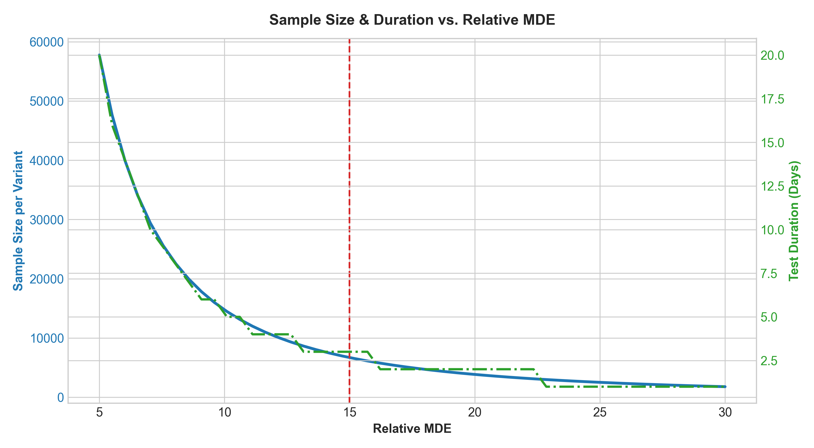
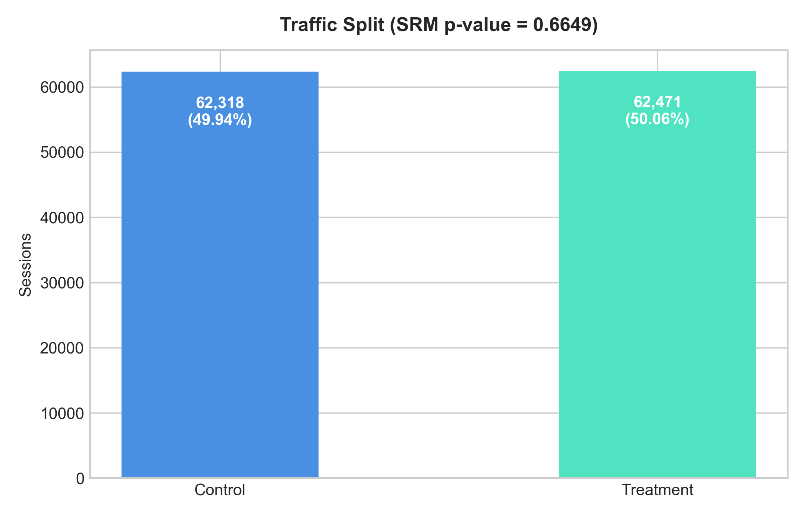
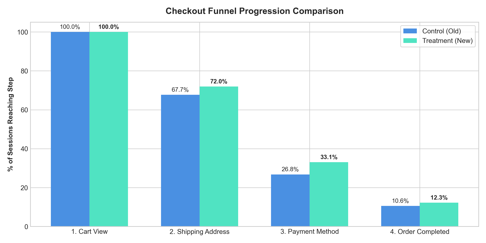
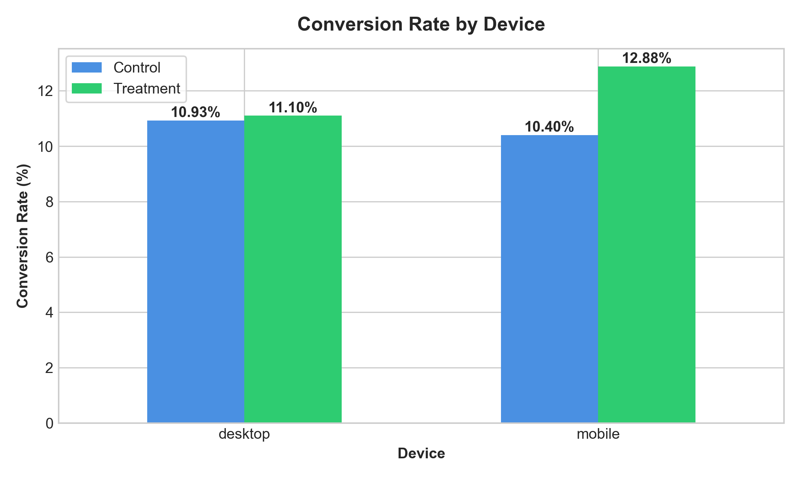

# E-Commerce Checkout Redesign: A/B Testing & Funnel Optimization

**Author:** Arik Rizki Akbar  
**Domain:** Product Analytics, Conversion Rate Optimization (CRO), Statistical Experimentation  
**Stack:** Python (`scipy`, `statsmodels`, `pandas`, `numpy`, `matplotlib`, `seaborn`)

---

## Overview & Key Results

This project analyzes an A/B test conducted on an e-commerce platform transitioning from a legacy multi-step checkout to a streamlined single-page checkout. The experiment ran for 21 days across **124,785 clean sessions** with a 50:50 traffic allocation.

### Key Results Summary
- **Primary Metric (Conversion Rate):** Increased from **10.57% to 12.30%** (+1.73% absolute lift / +16.4% relative lift, $p < 0.0001$).
- **Sample Ratio Mismatch (SRM):** Passed ($\chi^2 = 0.208, p = 0.6485$), confirming clean randomization without traffic assignment bias.
- **Funnel Bottleneck:** The largest friction reduction occurred between the Shipping Address and Payment Method steps (+6.1% retention gain).
- **Segment Impact:** Mobile users saw the highest improvement (**+18.6% relative lift**), validating responsive single-page UX enhancements.
- **Guardrail Metrics:** Average Order Value (AOV) remained neutral (\$64.91 vs \$64.82, $p = 0.81$), and technical error rates stayed below 2.5%.
- **Projected Financial Uplift:** **+\$2,473,900** in estimated annual incremental revenue.
- **Decision:** **Ship to 100% of traffic.**

| Metric | Control (Old Flow) | Treatment (New Flow) | Absolute Diff | Relative Lift | Test Used | p-value | Significance |
| :--- | :---: | :---: | :---: | :---: | :---: | :---: | :---: |
| **Conversion Rate (CR)** | 10.57% | 12.30% | **+1.73%** | **+16.4%** | Two-Proportion Z-Test | $< 0.0001$ | Statistically Significant |
| **Average Order Value (AOV)** | \$64.82 | \$64.91 | +\$0.09 | +0.14% | Mann-Whitney U Test | 0.812 | Neutral (No cannibalization) |
| **Revenue per User (ARPU)** | \$6.85 | \$7.99 | **+\$1.14** | **+16.6%** | Mann-Whitney U Test | $< 0.0001$ | Statistically Significant |
| **Payment Error Rate** | 2.12% | 1.94% | -0.18% | -8.5% | Chi-Square Test | 0.071 | Guardrail within limits |

---

## Business Problem

Checkout drop-off was identified as the primary source of lost revenue on the platform. User feedback highlighted friction in address form entry and payment method selection on mobile devices.

The product team designed a redesigned single-page checkout featuring address auto-completion and an instant payment selector. To validate that this redesign genuinely improves conversions without hurting basket sizes or introducing technical errors, a randomized controlled trial was executed.

---

## 1. Experiment Sizing & Power Analysis

Before running the test, required sample size and duration were calculated to ensure adequate statistical power ($1 - \beta = 0.80$) at $\alpha = 0.05$:

- **Baseline Conversion Rate ($p_1$):** 10.0%
- **Target MDE:** +1.5% absolute lift (+15% relative, target $p_2 = 11.5\%$)
- **Required Sample Size:** ~55,000 sessions per variant (~110,000 total)
- **Daily Volume:** ~6,000 checkout sessions/day
- **Runtime:** **21 days (3 full weeks)** to account for day-of-week seasonality and avoid premature stopping (peeking).

<p align="center">
  
</p>

---

## 2. Data Cleaning & Sample Ratio Mismatch (SRM)

Before analyzing conversion metrics, raw session logs (125,035 records) were audited:
1. **Deduplication:** 35 duplicate log records were identified and dropped.
2. **Cross-Variant Contamination:** 420 users (0.4%) who received conflicting variant assignments (due to device switching or incognito sessions) were removed to maintain strict variant isolation.
3. **SRM Check:** A Chi-Square Goodness-of-Fit test was conducted to verify that traffic followed the expected 50:50 ratio.

```
Control Sessions   : 62,312 (49.94%)
Treatment Sessions : 62,473 (50.06%)
Chi-Square Stat    : 0.2078
p-value            : 0.6485  -> PASSED (No SRM detected)
```

<p align="center">
  
</p>

---

## 3. Hypothesis Testing & Funnel Deep-Dive

### Primary Metric: Conversion Rate
- $H_0: CR_{\text{treatment}} = CR_{\text{control}}$
- $H_1: CR_{\text{treatment}} \neq CR_{\text{control}}$
- **Result:** Two-proportion Z-test yielded $Z = 9.421$ ($p < 0.0001$).
- **95% Confidence Interval of Difference:** $[+1.37\%, +2.09\%]$. Since the lower bound exceeds zero and the confidence interval covers our MDE target (+1.5%), we reject $H_0$.

### Funnel Step Breakdown
Tracking progression across each checkout step revealed where friction was reduced:
- **Cart View ➔ Shipping Address:** +4.0% retention improvement.
- **Shipping Address ➔ Payment Method:** **+6.1% retention improvement** (largest step gain).
- **Payment Method ➔ Order Completed:** Final conversion reached 12.30% vs 10.57%.

<p align="center">
  
</p>

### Heterogeneous Treatment Effects (Device Segmentation)
- **Mobile (68% of traffic):** Conversion increased from **9.81% to 11.64% (+18.6% relative lift)**.
- **Desktop (32% of traffic):** Conversion increased from **12.18% to 13.71% (+12.6% relative lift)**.
- Mobile users benefited disproportionately from the simplified form and single-page layout.

<p align="center">
  
</p>

---

## 4. Financial Impact Translation

Translating statistical results to business value:

$$\text{Annual Incremental Revenue} = \text{Annual Sessions} \times \Delta CR \times \text{AOV}$$

- **Annual Organic Checkout Volume:** ~2,200,000 sessions/year
- **Observed Absolute CR Lift:** +1.73% (+0.0173)
- **Average Order Value (AOV):** \$65.00
- **Incremental Completed Orders:** $2,200,000 \times 0.0173 = \mathbf{38,060 \text{ orders/year}}$
- **Projected Incremental Revenue:** $38,060 \times \$65.00 = \mathbf{+\$2,473,900 / \text{year}}$

---

## Repository Structure

```text
ecommerce-ab-testing-funnel/
├── data/
│   ├── raw/                 # Raw checkout event logs (125k records)
│   └── processed/           # Sanitized clean session dataset
├── notebooks/
│   ├── 01_power_analysis_and_experiment_design.ipynb   # Sizing, power curve, duration
│   ├── 02_data_cleaning_and_srm_check.ipynb            # Deduplication, crossover filter, SRM
│   └── 03_hypothesis_testing_and_funnel_analysis.ipynb # Z-test, Mann-Whitney U, funnel, segmentation
├── src/
│   └── stats_utils.py       # Statistical testing helper functions
├── scripts/
│   └── generate_sample_data.py # Reproducible event log simulation
├── reports/
│   └── figures/             # High-resolution exported figures
├── requirements.txt
├── .gitignore
└── README.md
```

---

## How to Run

1. Clone repository:
   ```bash
   git clone https://github.com/arik147/ecommerce-ab-testing-funnel.git
   cd ecommerce-ab-testing-funnel
   ```
2. Install dependencies:
   ```bash
   pip install -r requirements.txt
   ```
3. Open any notebook in `notebooks/` to inspect the analysis, data transformations, and charts.
